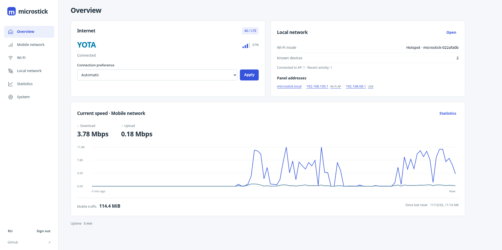

  

<h1 align="center">microstick</h1>

Custom Linux firmware for USB modems.

<strong>EN</strong> | <a href="README.ru.md">RU</a>

microstick is Linux firmware for MSM8916 USB modems. It lets your modem share internet over Wi-Fi and USB, run your own programs, and use plugins. You can configure the device in a browser and access the system over SSH.

microstick can run from a standard USB power adapter or a power bank, with no computer connected. The modem can share internet over Wi-Fi and run installed services on its own. The local network keeps working even without internet access.

## Features

- Share mobile internet over Wi-Fi and USB.
- Use an existing Wi-Fi network to get a computer online over USB.
- Configure networking and access rules in the web panel.
- View connected devices and traffic statistics.
- Run your own programs and plugins.
- Update the firmware while keeping settings and data, and create or restore backups.

## Plugins

Extend microstick with your own programs and scripts without rebuilding the firmware.

The web panel and traffic statistics are plugins too. You can disable or replace them without affecting networking.

Plugins start automatically, restart if they exit, and can keep their data across reboots.
See the [plugin documentation](./buildroot-external/board/msm8916/overlay/usr/share/microstick/default-plugins/README.md) for installation and development details.

## Quick start

You need a Linux x86_64 computer and a compatible MSM8916 USB modem.
Installation replaces the current firmware. The installer checks support before writing and creates a backup for rollback.

1. Download the Linux x86_64 archive from the [latest release](https://github.com/microstick-os/microstick/releases/latest).
   Extract the archive and run `./flasher` from the extracted folder.
2. Plug in the modem while holding its button to enter EDL flashing mode.
   Choose **Install**, set up Wi-Fi and passwords, then select **Install**.
3. Wait for the completion message before unplugging the modem. Plug it back in without pressing the button. The first boot prepares storage. Wait for your Wi-Fi network to appear.
4. Join that network or connect over USB. Open [microstick.local](http://microstick.local/) or [192.168.100.1](http://192.168.100.1) and sign in with the Wi-Fi/panel password you set. Over USB, you can also use [192.168.68.1](http://192.168.68.1/).

If Linux denies USB access, close the installer and run `sudo ./flasher`.
For SSH, use `ssh root@192.168.100.1` when connected to the microstick Wi-Fi hotspot, and enter your root/SSH password.

## More details

- [Source code](https://github.com/microstick-os/microstick) and [issues](https://github.com/microstick-os/microstick/issues)
- [Installation and recovery](docs/flasher.md)
- [Network settings and device commands](docs/architecture.md)
- [Adding and managing plugins](buildroot-external/board/msm8916/overlay/usr/share/microstick/default-plugins/README.md)
- [Traffic statistics](buildroot-external/board/msm8916/overlay/usr/share/microstick/default-plugins/statistics/README.md)
- [For developers: build from source](docs/development.md)
