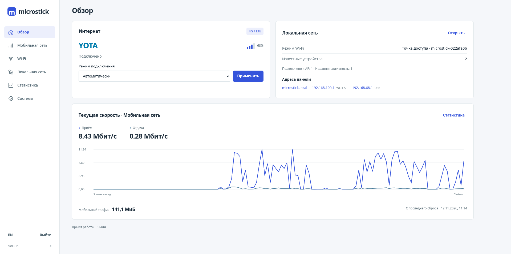

  

<h1 align="center">microstick</h1>

Кастомная Linux-прошивка для USB-модемов.

<a href="README.md">EN</a> | <strong>RU</strong>

microstick – Linux-прошивка для USB-модемов на MSM8916. С ней модем может раздавать интернет по Wi-Fi и USB, запускать собственные программы и работать с плагинами. Настраивать устройство можно через браузер, а для доступа к системе есть SSH.

Для работы microstick не нужен постоянно подключённый компьютер – достаточно питания от обычного USB-адаптера или powerbank. Модем может самостоятельно раздавать интернет по Wi-Fi и запускать установленные сервисы. При этом локальная сеть продолжит работать даже без доступа к интернету.

## Возможности

- Раздавать мобильный интернет по Wi-Fi и USB.
- Использовать существующую сеть Wi-Fi для подключения компьютера к интернету через USB.
- Настраивать сеть и правила доступа через веб-панель.
- Просматривать подключённые устройства и статистику трафика.
- Запускать собственные программы и плагины.
- Обновлять прошивку с сохранением настроек и данных, создавать и восстанавливать резервные копии.

## Плагины

В microstick можно добавлять собственные программы и скрипты без пересборки прошивки.

Даже веб-панель и статистика трафика здесь работают как плагины. Их можно отключить или заменить, не затрагивая работу сети.

Плагины запускаются автоматически, перезапускаются после завершения и могут хранить свои данные между перезагрузками устройства.
Подробнее об установке и разработке в [документации плагинов](./buildroot-external/board/msm8916/overlay/usr/share/microstick/default-plugins/README.md).

## Быстрый старт

Нужны компьютер с Linux x86_64 и совместимый USB-модем на MSM8916.
Установка заменит текущую прошивку. Установщик проверит поддержку устройства
перед записью и создаст бэкап для отката. 

1. Скачайте архив для Linux x86_64 из [последнего релиза](https://github.com/microstick-os/microstick/releases/latest).
   Распакуйте архив и запустите `./flasher` из распакованной папки.
2. Подключите модем к USB, удерживая кнопку на корпусе, чтобы войти в режим прошивки EDL. Выберите **Установка**, настройте Wi-Fi и пароли, затем нажмите **Установить**.
3. Дождитесь сообщения о завершении, затем отключите модем и подключите снова без нажатой кнопки. При первом запуске устройство подготовит хранилище. Дождитесь появления вашей сети Wi-Fi.
4. Подключитесь к этой сети или по USB. Откройте [microstick.local](http://microstick.local/) или [192.168.100.1](http://192.168.100.1) и войдите с заданным паролем Wi-Fi и панели. По USB также доступен адрес [192.168.68.1](http://192.168.68.1/).

Если Linux сообщает об отказе в доступе к USB, закройте установщик и запустите `sudo ./flasher`. 
Для доступа по SSH выполните `ssh root@192.168.100.1` (при подключении к точке доступа) и введите пароль root/SSH.

## Подробнее

- [Исходный код](https://github.com/microstick-os/microstick) и [сообщения о проблемах](https://github.com/microstick-os/microstick/issues)
- [Установка и восстановление](docs/flasher.md)
- [Настройки сети и команды устройства](docs/architecture.md)
- [Добавление и управление плагинами](buildroot-external/board/msm8916/overlay/usr/share/microstick/default-plugins/README.md)
- [Статистика трафика](buildroot-external/board/msm8916/overlay/usr/share/microstick/default-plugins/statistics/README.md)
- [Для разработчиков: сборка из исходников](docs/development.md)

Собственный код microstick распространяется под [MIT](LICENSE). Исключения и
условия сторонних компонентов перечислены в [THIRD_PARTY_NOTICES.md](THIRD_PARTY_NOTICES.md).
